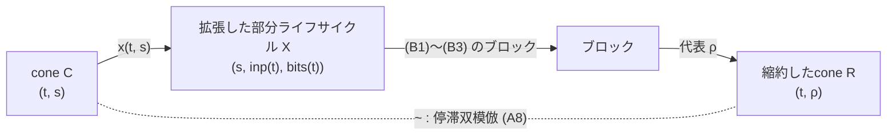

> 原文: [docs/theory/cones.md](https://github.com/manji-0/rdra-ish-dsl/blob/169cdf3fb49bbcaf0c7d452c32a57da18720fdd0/docs/theory/cones.md) · 対象：main `169cdf3`（v3.0.0以降の未リリース版。v3.0.0の挙動と一致しない箇所があります）

<!-- constrained-by ./semantics.md -->

このページは、upstreamの `docs/theory/cones.md` の日本語解説です。全訳ではありません。原文はmain `91524792` 時点のコードを記述しています。上の `169cdf3` は、この解説が読んだ原文のコミットです。

原文が答える問いは1つです。`T_β(M)`（D13）の代わりに小さい系を探索したとき、いつ同じ判定が得られるか。小さい系は4種類あります。

- 影響範囲のcone（cone of influence）
- 独立した部分ライフサイクルで縮約したcone
- スロットの置換を同一視した実行（インスタンス対称性）
- インスタンス数を増やした実行（範囲の引き上げ）

対象は [主張の一覧](/projects/rdra-ish/theory/claims/) の (a) 節、A1〜A28です。記法は [意味論と記法](/projects/rdra-ish/theory/semantics/) のものを使います。証明の全文、表の全行、テスト名の網羅は、各節からupstreamの該当見出しへリンクします。

## 読み方

原文の各結果は、命題、仮定とそれを成り立たせるコード、証明、証拠の4部分からなります。全ステップを示した証明は **Proof**、ステップの名前だけ挙げるものは **Proof sketch** です。通らないステップや、コードが与えない保証は、出てきた場所で名指しされます。

| 証拠の種類 | 意味 |
|---|---|
| `P-full` | 紙の上の証明で、ステップごとに確かめられるもの |
| `P-sketch` | 証明の概略。依拠する事実を挙げるが導出しない |
| M | 機械検査。Kani、shadow twin、debug・`shadow` ビルドの毎ステップ検査、Lean 4の証明 |
| R | 実行時検査。利用者の実行ごとに自分の出力を検査し、失敗すればツールエラーにする |
| D | 差分テスト。エンジンコーパス、サンプル比較、ランダムモデル、ミューテーション実行など |

Leanの証明は、仮定から定理への論証を検査します。ただしRustのコードは読みません。コードが仮定を満たすことは、Leanでは示されません。この区別は縮約と対称性の節で何度も効いてきます。原文の振る舞いに関する記述は、すべてコードを読んだ確認です。

| 主張 | 内容 | 節 |
|---|---|---|
| A1 | 厳密なcone | [射影と持ち上げ](#射影と持ち上げ) |
| A2, A3, A27, A28 | 過大近似のcone、カウンタ、包含、解放したスロット | [安全性のcone](#安全性のcone) |
| A4〜A6 | `property` のcone | [`property` のcone](#property-のconeと公平性) |
| A7 | `can_reach` のcone | [`can_reach` のcone](#can_reach-のcone) |
| A8〜A14, A16, A17 | 部分ライフサイクルによる縮約 | [縮約](#独立した部分ライフサイクルによる縮約) |
| A15 | 縮約したcone上の `WF_vars(Next)` | [`WF_vars(Next)`](#縮約したcone上の-wf_varsnext) |
| A18〜A23 | インスタンス対称性 | [インスタンス対称性](#インスタンス対称性) |
| A25 | 範囲の引き上げ | [範囲の引き上げ](#範囲の引き上げ) |
| A24, A26 | 上限、メモリ上限、`not decided` | [上限](#上限メモリ上限not-decided) |

## 追加の記法

[原文: Notation added here](https://github.com/manji-0/rdra-ish-dsl/blob/169cdf3fb49bbcaf0c7d452c32a57da18720fdd0/docs/theory/cones.md#notation-added-here)

`T = T_β(M) = (S, I, →)` とし、変数は `V`（D2）、アクションは `A`（D6）です。`T` は「ビルダーが返す系」と読みます。それがD13の `T_β(M)` に等しいことは主張I1で、ここの定理はI1を必要としません。アクション `a` について次の集合を使います（`cone.rs::TransitionSystem` の関数）。

| 記号 | 関数 | 中身 |
|---|---|---|
| `Rd(a)` | `plain_reads` | `Existing`・`Parent` 引数の存在、コピーガードとマークガード以外のガードの読み、遷移の元、`Tick` の `now` |
| `Mk(a)` | `mark_reads` | 読むraiseの印 `μ`（D11）ごとの `(μ, R_μ)`。`R_μ` は `μ` が選ぶ `Triggered` 引数の存在とそのガードの読み |
| `Cp(a)` | `copy_reads` | コピーガードごとの `(τ, R_τ)`。`τ` は後続状態で固定する列 |
| `Wr(a)` | `action_writes` | 効果が書く変数。`Delete` は存在・全列・全オーナー |
| `ex(v)` | `existences` | `v` のエンティティの存在。オーナーなら親の存在も |

`Wr(a)` は構文から決まり、1ステップが変えうるものを過大近似します。D8は削除行のオーナーを残しますが、`Wr` はそれも挙げます。過剰に挙げても、coneにアクションが増えるだけです。

ガードの読みは `pred_reads` から取ります。Kaniのハーネス3本が、`pred_reads` が `eval` の読むものを覆うことを小さい形について示します（[engine-agreement.md](https://github.com/manji-0/rdra-ish-dsl/blob/169cdf3fb49bbcaf0c7d452c32a57da18720fdd0/docs/engine-agreement.md#kani-harnesses)）。「1ステップは `Wr(a)` だけを変える」ことにはハーネスがありません。代わりに、すべてのビルドが書き込みを1回ごとに `Wr(a)` と照らします（`explore/successor.rs::Successor`）。debug・`shadow` ビルドはステップ全体も比べます（`check_writes`）。

`π_W` は状態を `W ⊆ V` に射影します。2つの振る舞いが **停滞同値** であるとは、同じ状態の有限の繰り返しを1つに潰すと一致することです。`A_W(K) = K ∪ {a : Wr(a) ∩ W ≠ ∅}` は、保持集合 `K` のもとで `W` が取り込むアクションです。

## 種からのcone

[原文: The cone of a seed](https://github.com/manji-0/rdra-ish-dsl/blob/169cdf3fb49bbcaf0c7d452c32a57da18720fdd0/docs/theory/cones.md#the-cone-of-a-seed)

**Definition 1（閉包）**：種 `σ ⊆ V` と保持集合 `K` について、`W ⊇ σ` が閉じているとは次の4条件を満たすことです（`A_W = A_W(K)`）。

- (C1) `A_W` のすべての `a` で `Rd(a) ⊆ W`
- (C2) `A_W` の `a` と `(μ, R_μ) ∈ Mk(a)` について、`exact_W(a, μ)` なら `μ ∈ W` かつ `R_μ ⊆ W`
- (C3) すべての `a` と `(τ, R_τ) ∈ Cp(a)` について、`τ ∈ W ⇒ R_τ ⊆ W`
- (C4) `W` のすべての `v` で `ex(v) ⊆ W`

`exact_W(a, μ)` は、`a ∈ K` か、`μ` が数える辺のカウンタ（`is_counted`）か、`μ` を書くアクションがすべて `A_W` の中なら成り立ちます。`cone(σ, K)` は最小の閉集合です。

**Lemma 1**：最小の閉集合は存在し、`TransitionSystem::cone` のループがそれを返します。各条件の前提は `W` について単調で、ループは条件が要求する変数だけを足し、`V` は有限だからです。`P-full` です。

種と保持集合は検査の種類ごとに違います。

| 対象 | 種と保持集合 `K` |
|---|---|
| エンティティのビュー `E` | `Exists(E)` と `E` の列。`K` は `E` の書かれる引数を持つアクション |
| 不変条件 | 束縛子の存在と本体の読み。`K = ∅` |
| `after(UC)` | 束縛子の存在、事後条件の読み、検査するステップの `Wr(a)`。`K` はそのステップ |
| `property` `P` | `property_reads(P)` と、公平なアクションの `Wr(a)` と `New` 引数のエンティティの存在。`K` は公平なアクション |
| `can_reach` | `keep_writers(·, true)` の不動点。`K` はconeに書くすべてのアクション |

`exact_target_cone(target, slots)` は `keep_writers(·, slots)` を回してから `cone` を取るもので、印を漏らすエンティティconeと `recheck_on` の最終ラウンドに使います。

**Definition 2（逸脱）**：`W = cone(σ, K)`、`C = T|W = restrict_to(W, K)` とします。

- **解放したエンティティ** `E`：`A_W` のアクションが `E` の `New` 引数を持つのに `Exists(E) ∉ W`（`cone_frees_slots`）
- **漏れた印** `μ`：`A_W` のアクションが `(μ, R_μ) ∈ Mk(a)` を持つのに `μ ∉ W`（`cone_leaves_marks`）
- **落ちたコピー**：`A_W` のアクションが `(τ, R_τ) ∈ Cp(a)` を持つのに `τ ∉ W`

前の2つがないとき、`W` は **厳密** です。落ちたコピーは厳密さを損ないません。

`restrict_to` は `A_W` のアクションと、`W` に書く効果、読みが `W` に収まるガードを残します。`W` の外を目標とするコピーガード、存在が `W` の外にある `New` 引数、印が `W` の外にある `Triggered` 引数は捨てます。(C4)により、coneにスタブはできません。

実行ごとに `cone_check.rs::cone_faults` が `σ ⊆ W` と (C1)〜(C4) を計算し直します。見るのは閉包で、最小性ではありません。不備があれば `V` 全体をconeにして警告します。`::restriction_faults` は各 `restrict_to` を上の規則と照らし、不備は実行をツールエラーで止めます。

## 射影と持ち上げ

[原文: Projection and lifting](https://github.com/manji-0/rdra-ish-dsl/blob/169cdf3fb49bbcaf0c7d452c32a57da18720fdd0/docs/theory/cones.md#projection-and-lifting)

この節と続く3節は、1ステップに関する2つの補題の上に立っています。

**Lemma 2（射影）**：`π_W(I_T) = I_C` です。`T` のステップ `s →_{a,p} s'` は、`a ∉ A_W` なら `W` から見て停滞し、`a ∈ A_W` なら `C` のステップ `π_W(s) →_{a|W, p|W} π_W(s')` に写ります。したがって `π_W(Reach(T)) ⊆ Reach(C)` です。**仮定は要りません。** 初期状態が成分ごとの直積であることと、(C1)で残るガードと効果が `W` の値だけで決まることから従います。

**Lemma 3（持ち上げ）**：`W` が厳密なら、任意の状態 `s`（到達可能でなくてもよい）と `C` のステップ `π_W(s) →_{a|W, p} r'` について、同じアクションと引数の `T` のステップ `s → s'` で `π_W(s') = r'` となるものがあります。証明は4つの場合からなります。

1. 引数は落ちません。`New` が落ちるのは解放したエンティティ、`Triggered` が落ちるのは漏れた印のときだけです
2. 落ちたコピーガード以外のガードは、`W` の部分で成り立ちます
3. 効果は `W` 上で `r'` の分岐を取り、`W` の外の `Choose` は任意の値を取ります
4. 落ちたコピーガードは、ビルダーの性質で処理します。コピー先はドメイン全体の `Choose` でしか書かれず（`build/sets.rs`）、同じ値を持つ列の間でしかコピーできません（`copyable`）。だからコピー元と同じ値を選べます

### Theorem A1（厳密なcone）

**命題**：`W` が厳密なら、`Reach(C) = π_W(Reach(T))` です。`C` の有限トレースは、アクションと引数を保ったまま `T` のトレースに持ち上がります。振る舞いも持ち上がり、`T` の振る舞いは停滞を許して `C` に射影されます。したがって、読みが `W` に収まる検査では、`C` の判定が `T` の判定です。

**依拠するもの**：Lemma 2と、Lemma 3の帰納法です。`after` では、検査するステップの書き込みが種にあるので、状態を変えるかどうかが射影でも同じです。

**仮定**：厳密さ（`cone_frees_slots` と `cone_leaves_marks` が偽）。トレースごとには `trace.rs::annotate` が `over_bound` と `free_triggers` を記録し、両方が空なら `Trace::vouched` が成り立ちます。

**証拠**：`P-full`。Dとして `core/tests/cone.rs` がconeの到達集合と全体の射影を比べます。逸脱のないconeでは等号を、あるconeではA2の包含を確かめます。

**脅威**：リリースビルドが検査するのは1回ごとの書き込みで、ステップ全体ではありません。`each_successor` に対するKaniのハーネスは数分で終わりませんでした。

## 安全性のcone

[原文: Safety cones](https://github.com/manji-0/rdra-ish-dsl/blob/169cdf3fb49bbcaf0c7d452c32a57da18720fdd0/docs/theory/cones.md#safety-cones)

### Theorem A2（過大近似のcone）

**命題**：厳密かどうかにかかわらず `π_W(Reach(T)) ⊆ Reach(C)` です。したがって、読みが `W` に収まる状態規則と `after` アサーション `R` で `C ⊨ R ⇒ T ⊨ R` です。`after` では、検査するステップが `K` にあり、その書き込みが種にあることが必要です。

**依拠するもの**：Lemma 2だけです。`T` で違反する状態やステップは `C` の違反に射影されます。

**限界**：A2が扱うのは **全称的な** 検査だけです。エンティティconeの所見（`NoWitness`、`NeverRuns`、`ArmNeverTaken`、`ValueNeverChosen`、`Deadlock`）は存在的か分岐的です。過大近似のconeは状態と辺が多いので、これらを `T` と逆に判定しえます。これらには厳密さ（A1）か、縮約したconeでのA8が要ります。

### Proposition A28（解放したスロットは大きい範囲で持ち上がる）

**命題**：`W` に漏れた印がなく、解放したエンティティの集合を `F` とします。`C` のトレース `ρ` が `E ∈ F` の `New` 引数を `c_E` 回束縛するなら、`ρ` は1ステップずつ `T_{β'}(M)` に持ち上がります。`E ∈ F` では `n'_E = max(n_E, c_E)`、それ以外は `n'_E = n_E` です。すべてで `c_E ≤ n_E` なら `T_β(M)` そのものに持ち上がります。

**依拠するもの**：`F` の変数は `W` にないので、`C` は `β` でも `β'` でも同じ系です。持ち上げはLemma 3と同じで、`F` の `New` 引数だけは最小の空きスロットに束縛します。スロットは再利用されません（D7）。

**コードとの対応**：`trace.rs::over_bound` は `c_E > n_E` の `E` を挙げ、CLIは `note: … creates more E instances than the instance bound allows` を出します。`over_bound` が空の反例は `T_β(M)` の違反、空でなければ `T_{β'}(M)` の違反です。

**証拠**：`P-full`。Dのテスト2本は、どちらもトレースを `T_{β'}(M)` に持ち上げてはいません。持ち上げは証明が担います。

### Corollary A28′（トレースごとの厳密さ）

`C` のトレース `ρ` のどのステップも `W` の外の印を読むアクションを実行しない（`free_triggers` が空）なら、`W` がほかで印を漏らしていても、`ρ` はA28と同じように持ち上がります。

**証明の概略**：Lemma 3とA28は厳密さを1ステップずつしか使いません。`W` 内の印 `μ` を読むなら、`μ` を書くアクションはすべて `A_W` にあり、(C2)が `R_μ ⊆ W` を与えます。コードから取る事実は、`free_triggers` がcone外の印を読むステップをすべて挙げることです。すべてのビルドが反例ごとにこれを検査します（`vouch.rs::free_trigger_faults`）。

### 漏れた印：候補と洗練

coneが印を漏らすと、`C` はイベントなしにハンドラを走らせます。イベントの順序（D11）はどの `β` でもその実行を禁じうるので、範囲を大きくしても救えません。そのような反例は **候補** にすぎず、数える前に判定し直します。反例に導かれた洗練（Clarkeら2000）と同じ手法です。

- `targets.rs::recheck_on` はラウンドを重ねます。vouchされた反例が出ればそれが判定です。そうでなければ `refine` が、トレースがイベントなしに走らせた印をraiseするアクションを `K` に足します。何も足せなければ厳密なcone（`exact_target_cone`）を回します。各ラウンドは保持するものを増やし、厳密なconeが上界なので終わります
- 厳密なconeの反例がvouchされなければ `Recheck::Fault` で、その検査のツールエラーです
- `verify` と `check` は、free triggerのある違反を判定し直し、vouchされたものと判定し直したものだけを数えます
- 印を漏らす `property` のconeは `ok` だけを数え、反例は `not decided` としてモデル全体で回します

**判定し直しが守るのは反例だけです。** 全称的な検査では、候補が誤った `ok` を生むことはありません（A2、A4.1）。防いでいるのは、候補を反例として印字することと、`at k instances` が必要な範囲を過小に言うことです。

### エンティティconeは印について厳密にする

エンティティconeの存在的・分岐的な所見では、漏れた印は誤った `ok` を生みます。`T` が止めているハンドラを `C` が走らせると、辺と状態が増えます。増えた辺は `T` のデッドロックから出ていけますし、増えた状態は `T` が到達しない状態のwitnessになりえます。所見が **消える** ので、トレースごとの検査では捕まりません。`NeverRuns` などはconeをまたいで集約されるので、1つのconeの漏れが実行全体の所見を隠します。

そこで `target_cone` は、印を漏らすエンティティに `exact_target_cone(target, false)` を返します。エンジンコーパスの `cone_entity_mark_left_out.rdra` がその例です。Orderの出口 `ShipOrder` が `Payment.status == paid` を読みます。`EvPaid` をraiseする `ReadNotice` はOrderのconeに何も書かないので取り込まれず、印が漏れます。漏れたままだと、Orderの `placed` でのデッドロックと `shipped` のwitness欠如が消えます。

解放したエンティティについては弱い形の問題が残ります。A28により、所見は大きい範囲での所見になります。

### Proposition A3（カウンタは漏れない）

**命題**：`W` が `triggers(Ev, UC).counted(k)` のカウンタ `κ` を含むなら、raise側と処理側のアクションはすべて `A_W` にあり、`κ` のマークガードは厳密です。後半の主張は「raise側を含むconeはカウンタを含む」です。

**依拠するもの**：前半はD11と(C2)の `is_counted` です。後半は、`count_up` と `count_down` がraiseと減算を `κ` 上の `Transition` として作ることに依ります。遷移の元は `plain_reads` に入るので、(C1)が `κ` を `W` に入れます。両方の半分が証明されています。

**証拠**：`P-full`（コードを読んだもの）。Rとして、縮約が使う分割はカウンタを `T` 側に置くことを毎回検査されます（`split_faults`）。Dのテストが確かめるのは縮約の分割で、coneそのものではありません。

### Proposition A27（包含されるcone）

**命題**：安全性のcone `C_s` に `ok (checked in Cone_X)`（D23）が出るのは、合格したcone `C_ℓ` について `Covered::covers` が成り立つときです。条件は、検査の包含、`W_s ⊆ W_ℓ`、`K_s ⊆ K_ℓ`、アクションごとのガードと引数の数の一致です。このとき `C_s` の各検査 `R` で `T ⊨ R` です。

**依拠するもの**：`C_ℓ` に対するA2です。`K` を合併しても、Lemma 2が使う`(C1)`と`(C4)`は保たれます。数の一致は判定には要らず、`covers` 自身の論証に要ります。

**証拠と脅威**：覆うconeの `ok` に相対的に `P-full` です。`C_ℓ` が縮約されていれば、その `ok` はA8に依ります。A27を名指すテストはありません。

## `property` のconeと公平性

[原文: Property cones and fairness](https://github.com/manji-0/rdra-ish-dsl/blob/169cdf3fb49bbcaf0c7d452c32a57da18720fdd0/docs/theory/cones.md#property-cones-and-fairness)

`P` を公平なアクション `Φ`（D20）を持つ `property` とし、`W = cone(property_seed(P))`、`K = Φ` とします。

**Lemma 4（公平なインスタンスはcone上で決まる）**：`Φ` のインスタンス `(a, κ)` が `T` の `s` で有効であることと、`C` の `π_W(s)` で有効であることは同値です。ステップが `s` を変えることと `π_W(s)` を変えることも同値です。公平なアクションは種の作り方により、落ちる引数とガードを持ちません。だから `W` がほかで厳密でなくても、Lemma 3が使えます。

### Theorem A4（`property` のcone）

**命題**：

1. （`ok`、種のほかに仮定なし）`Plain` のもとで `C ⊨ P` なら `T ⊨ P`。したがって `WfNext`（D21）のもとでも成り立ちます
2. （反例、`W` が厳密）`Plain` のもとで `C ⊭ P` なら `T ⊭ P`

**依拠するもの**：(1)は、`T` の違反する振る舞いをLemma 2で射影し、Lemma 4で `Fair_P` を保ちます。(2)はLemma 3で持ち上げます。`always` では違反する有限の接頭辞で足ります。有限系では、どの状態からも全公平性を満たす無限の振る舞いが作れるからです（弱公平性のマシン閉包、AbadiとLamport 1991）。(2)が厳密さを要るのは、公平でないアクションだけです。

**証拠**：縮約前のcone `C` についての命題として、Lemma 2〜4のもとで `P-full` です。

### Theorem A5（1つの `property` の実行）

`eventually` と `leads_to` には3つの実行があります。`whole` はすべての `Wr(a) ⊆ W` を指します。

1. `Cone_P`（`Plain`）の `ok` ⇒ `WfNext` のもとで `T ⊨ P`。この実行が読むのは **縮約した** cone `R` です。だから含意はA8.4（`R ⊨ P ⇔ C ⊨ P`）、A4.1、D21の順につながります
2. `Cone_P_WF`（`C` 上の `WfNext`）の反例で `W` が厳密 ⇒ `T ⊭ P`
3. `Cone_P_WF` の `ok` かつ `whole` ⇒ `T ⊨ P`。`whole` なら `A_W = A` で、`WF_vars(Next)` が射影されます。縮約したconeでは、この `ok` はA15に依ります

どれも決まらなければ、`T` 上で `RdraSpec_P` を回すか、判定は `not decided` です。

**証拠と脅威**：A5.2は `P-full`。A5.1と縮約したcone上のA5.3はA8・A15に依るので、平坦な縮約では仮定に相対的に `P-full`、入れ子や `H` までの実行では `P-sketch` です。

### Proposition A6（逸脱のある `property` のcone）

**命題**：解放したエンティティか漏れた印のあるconeでは、反例はすべて `Undecided(why)` に写り、`ok` だけを取ります。`ok` の論証は形式で分かれます。

- `stable`・`unchanged`・`precedes` は縮約しないconeを読み、A4.1とA2で健全です
- `always`・`eventually`・`leads_to` は縮約したconeを読み、A8（1と4）、A4.1、A2で健全です。A8は平坦な縮約では証明済み、入れ子や `H` までの実行では概略です

## `can_reach` のcone

[原文: `can_reach` cones](https://github.com/manji-0/rdra-ish-dsl/blob/169cdf3fb49bbcaf0c7d452c32a57da18720fdd0/docs/theory/cones.md#can_reach-cones)

### Theorem A7

**命題**：`reach_seed(i)` のcone `W` は厳密です。到達可能な `s` と束縛 `b` について、D22の式は `T` の `s` と `C` の `π_W(s)` で同じ値を取ります。`can_reach` のconeは縮約しません。

**依拠するもの**：`keep_writers(seed, true)` の不動点では `A_W = K` で、印はすべて厳密、作られるエンティティの存在はすべて種にあります。証人の経路はLemma 3で持ち上げ、Lemma 2で射影します。縮約したconeでは `drop_unreadable_checks` が `can_reach` を消します（コメントいわく、縮約は「`AG EF` について何も言わない」）。

**証拠**：`P-full`。Dは `core/tests/reach.rs` です。

## 独立した部分ライフサイクルによる縮約

[原文: The reduction by an independent sub-lifecycle](https://github.com/manji-0/rdra-ish-dsl/blob/169cdf3fb49bbcaf0c7d452c32a57da18720fdd0/docs/theory/cones.md#the-reduction-by-an-independent-sub-lifecycle)

原文で最も長い部分です。まず考え方を述べ、それから定義・補題・定理を原文の名前のまま追います。

### 考え方

coneの変数を、検査対象の側 `T_v` と、対象が書かず一部しか読まない側 `S_v` に分けます。アクションも `T_v` に書く `T_a` と、`S_v` だけに書く `S_a` に分かれます。`T_a` が `S_v` から読むのは `obs` という一部の変数だけです。

直観的には、`T` 側から区別できない `S` 側の状態はまとめても判定が変わりません。そこで `S` 側だけを単独で探索し、状態を **ブロック** に分けます。同じブロックの状態は、`obs` と、`S` が読む `T` 側の値（入力とビット）で区別できません。各ブロックから代表を1つ選び、`S_v` を代表に置き換えた系 `R` が **商** です。

`R` では、`S_a` のステップは「別のブロックへのクラス移動」になり、ブロック内のステップは見えません。だから `C` と `R` の対応は、見えないステップ（停滞）を許した対応、つまり **停滞双模倣** です。「発散を区別しない」は、ブロック内で無限に回る経路とそこで止まる経路を区別しないことです。この差が効くのは `WF_vars(Next)` だけで、A15で扱います。

### 証明の状態

| 対象 | 状態 |
|---|---|
| 平坦な縮約（`X` に内側の縮約がなく、`H` までの実行でもない） | Lemma 5、Lemma 6、Theorem A8、A15が紙の上でステップごとに、かつLeanで証明済み。ただし `Lemma6Hyp` の各フィールドや (B1)〜(B3) などの仮定に相対的 |
| 仮定とコードの結び付き | 多くは実行時検査（R）。`Lemma6Hyp.exact` などはコードを読んだ確認だけ |
| 入れ子の縮約 | `Nested.lean::a8_nested` は深さの帰納法を証明する。しかしコードの読み方と `X` を結ぶ段階は名前だけで、組み立てていない。概略 |
| `S` を `H` まで回す実行 | A22に依る。概略 |

### Definition 3（分割）

`reduce/split.rs::split_with` は、アンカー（種が読む各変数）の中から `T` 変数が最も少ない分割を選びます。`split_at` は次を満たす最小の `T_v` と `T_a` を求めます。

- アンカーとすべてのカウンタは `T_v` にあります
- 保持されるアクション、`T_v` に書くアクション、`T_v` の非単調な変数を読むアクションは `T_a` にあり、`Wr ⊆ T_v` です
- 変数とそのエンティティの存在は同じ側にあります

`S_v = V_C ∖ T_v`、`S_a` は `T_a` の外の書くアクションです。`obs` は `T_a` と種が読む `S_v` の変数です。`inputs` は `S_a` が生で読む `T_v` の変数とその存在です。`folds` は、`T` の読みをキーのスロットごとの1ビットに畳む `S_a` のアクションです（`reduce/fold.rs`）。**単調** は `monotone_vars` が決めます。書き込みの辺が自己ループ以外の閉路を作らず、カウンタでも削除されるエンティティの列やオーナーでもないことです。

### Lemma 5（分割）

**命題**：`(a)` `S_a` は `S_v` だけに書きます。`(b)` `T_a` は `T_v` だけに書き、`S_v` は `obs` でしか読みません。`(c)` `S_a` の読みは `S_v`、`inputs`、畳み込みに収まります。`(d)` 入力はすべて単調です。`(e)` 種の `S_v` の読みは `obs` に収まり、保持されるアクションは `T_a` にあります。

**仮定**：`split_at` の結果を、Definition 3の条件で閉じた組として読みます（`Split.lean::Closed`）。畳み込みについて3つの事実 `raw_rd`、`cover`、`ex_mono`（`Split.lean::FoldData`）も取ります。

**証明**：各部分は閉包条件か定義の1つです（`Split.lean::lemma5_of_closed`）。たとえば(a)は、`S_a` が `T_v` に書けば閉包が `T_a` に入れるからです。ループの挿入順によらず最小の閉じた組になることは `computed_iff` と `mem_eq_of_sound` が示します。各挿入が条件の1つを適用することはコードの読みです。

**実行時の証明書**：すべてのビルドが、縮約が使う前に (a)〜(e) と側の規則を検査します（`reduce/lemma5.rs::split_faults`）。検査は `Rd` と `Wr` を自分で計算し、`split_at` からは何も取りません。不備があれば縮約せずに判定して警告し、debug・`shadow` ビルドはpanicします。だから(a)〜(e)は、入れ子を含め、使われるすべての分割で成り立ちます。示さないのは、`action_reads` などが遷移関係の読み書きであることと、`monotone_vars` の健全性（A10）です。

**証拠**：`P-full`（閉包と `FoldData` に相対的）、Rは上の証明書。Mは `Split.lean` で、アクション単位のモデル（`Actions.lean`）上の証明です。局所性 `Local` と合わせ、(a)(b)がA8のLean証明の仮定 `Split` を与えます。`Local` はA18のスロットモデルの定理です（`SymActModel.lean::local_`）。コードのアクションがその構文であることは読みです。`scripts/check-lean-certificates.sh` は分割をLeanで健全と証明したチェッカーにかけますが、手で回すもので、CIでは回りません。

### Definition 4（拡張した部分ライフサイクルと商）

`X`（`reduce/extended.rs::Extended::build`）は `restrict_to(S_v ∪ inputs)` に、畳み込みのグループごとのビット変数と、ビットごとの自由な `Rise`・`Fall` を足したものです。辺は2種類あります。`S_a` の辺は **silent**、入力を書く `T_a` の制限とビットの反転は **rise** です。`X` を探索した状態集合を `X_n` とし、`quotient_blocks` は `X_n` の分割 `B` を返します。分割は次を満たすことを意図します。

- (B1) 同じブロックの2状態は、`obs`、生の入力、ビットで一致する
- (B2) silentな辺に対する発散を区別しない停滞安定性。ブロック `B ≠ B'` について、`B` の全状態が `B` の中だけを通るsilentな経路で `B'` に入れるか、どれも入れないか（GrooteとVaandrager 1990）
- (B3) riseに対する強い安定性。同じブロックの2状態は、1回のriseで同じブロックの集合に入る

`R` は `C` の `S_v` をブロックの代表（`Reduction::reps`）に置き換えた系です。`T_a` はそのまま走り、入力を変えるステップは段階（`Reduction::stages`）ごとに1回のriseでブロックを動かします。`S_a` はクラス移動（`Classes::moves`）になります。`C` の状態 `(t, s)` には拡張した状態 `x(t, s) = (s, inp(t), bits(t))` が対応します。

**スタブ**：`S_v` のオーナー変数の親が `T` にあり、その存在が `S_v ∪ inputs` にないとき、`restrict_to` は親を存在だけのエンティティとして残します。スタブの存在は `X` で定数なので、その上の `Existing`・`Parent`・`Triggered` 引数は、coneが束縛する所で束縛できなくなります。`bind_stub_params` はそれらに `Earlier { step: 0 }` を与え、任意のスロットに束縛させます。すべてのビルドが作った `X` をこの定義と照らし（`StubCheck`）、不備があれば縮約しません。

### Lemma 6（拡張した系はconeを覆う）

`C°` を、`T_a` の外で何も書かないアクションのステップを除いた `C` とします（到達状態は `C` と同じ）。到達可能な `(t, s)` について次が成り立ちます。

1. 初期状態は `X` の初期状態に写り、`x(t, s) ∈ X_n`（内側の縮約の正準形を除いて）
2. （`C ⇒ X`）`C°` の `S_a` のステップは、同じアクション・同じ束縛の `X` のsilentな辺
3. （`X ⇒ C`）`X` のsilentな辺は `C°` の `S_a` のステップ。束縛は畳み込みの自由な `T` 引数の外で一致
4. `T_a` のステップは、`stages(inp(t), inp(t'))` の段階ごとに1回の `X` のriseに対応

**仮定**：平坦な縮約と、自分のビットを持つ引数の畳み込み（`FoldKey::Param`）についての証明です。`C` と `X` を `Restrict.lean` のモデルとして読み、アクションごとに `Restrict.lean::Lemma6Hyp` の16フィールドを仮定します。コードがそれを満たす根拠は次のとおりです。

| 根拠 | フィールド |
|---|---|
| R（`lemma6_faults`、`split_faults`、`StubCheck` が毎ビルド検査） | `lemma5`、`reads`、`kept_rd`、`cover`、`rise_eff`、`fold_sa`、`folded_og`、`folded_names`、`other_names`、`eff_names`、`eff_s`、`bind` |
| MとR。コードのアクションをモデルに結ぶ部分は読み | `local_`、`shape`、`new_writes` |
| 読みだけ。どの実行も検査しない | `exact`（スロット `c` のビットが真 ⇔ キーを `c` にした束縛で畳まれたガードがすべて真）。`Twin::FoldHolds` は2つの実装の比較 |

`lemma6_faults` のRは `FoldKey::Param` と単独のビットについてのものです。ノードの畳み込みとビットを共有するグループでは、畳み込みのフィールドは読みです。`cover` の `X` との結び付きは、ガードを1つずつ照合せず個数で比べます。読み替えたガードはステップを増やすだけで、反例の再生がそれを退けます（N16）。

**証明の流れ**（10ステップ、`Lemma6.lean` の名前空間 `Act.Ext`）：

- `x(t, s)` と `(t, s)` は `S_v ∪ inputs` で一致し、`X` が残すガードは両方で同じ値を取ります（`xval_inp`、`kept_iff`）
- 役割の候補スロットは `X` でも候補です。スタブ上では `bind` により任意のスロットが候補になります（`xrole_cand`）
- `C ⇒ X` では、畳まれたガードを満たす束縛そのものは `exact` の前提を満たすので、ビットが立ちます（`xguard_of_guard`）
- `X ⇒ C` では、ビットが立てば `exact` により畳まれたガードを満たす束縛があり、自由な `T` 引数だけ替えてcone側のステップを作れます（`s_back`）
- riseは、生の入力を設定する1段と、違うビットごとの反転からなります（`rise_fwd`、`flips_end`）

項目1は到達可能性の帰納法です（`x_reach`）。項目1〜4がA8のLean証明の仮定 `Lemma6Fwd`・`Lemma6`・`Lemma6By`・`Lemma6Staged` になります。

**証明がモデル化しない部分**：初期状態は毎ビルド検査されます。ビットを共有するグループ、ノードの畳み込み、引数の位置、キーが落ちる畳み込み（`Fault::KeyDropped` で縮約しない）は紙の上の論証です。残る2つが概略の部分です。

- **入れ子の場合**：`x(t, s)` は内側の正準形を除いてしか `X_n` にありません。各段で内側のconeのA8が要り、深さの帰納法は名前だけで書かれていません
- **`H` までの実行**：`X_n` は `H` の正準形を除いた状態を持ち、証明書は軌道グラフを読みます。この段はA22のもので、概略です

**引数の場合分け**：原文には、束縛が `C` と `X` で同じ後続を与えることを示す長い表があります。軸はアクションの種類（畳まれた `S_a`、畳まれない `S_a`、rise、ビットを書くもの、`steady` な `T_a`）、引数の側（`S`、入力、スタブ、落ちたもの）、役割の3つです。多くのセルは4つの事実で決まります。`(P1)` `S` の行は同じように束縛される。`(P2)` 入力の行も同じで、ガードが少ないだけ。`(P3)` スタブの行は任意のスロットに束縛される。`(P4)` 落ちたエンティティの行は消える。これらは制約を落とすだけなので、`X` は `C` の束縛をすべて許します。各セルは落としたものが後続を変えないことを示し、テストモデルが埋めます（`Reduction::param_cells`）。到達可能なのに誰も埋めないセルが3つ残ります。

これを支える読みが3つあります。(a) `Fold::holds` は畳まれたガードを計算する（`exact` はこれに依る）。(b) スロット0に束縛した落ちた `T` 引数は後続を失わない。(c) riseは `T` のステップが書くものを書く。

**証拠**：平坦な縮約では `Lemma6Hyp` に相対的に `P-full`、入れ子と `H` までの実行では `P-sketch` です。

- M：`Lemma6.lean` が項目1〜4を証明し、`Lemma6Example.lean` が具体的なモデルで `Lemma6Hyp` を満たします。`bind_stub_params` を外すとそこで崩れます（`stub_bug`）
- D：`core/tests/reduce.rs` が畳み込みのある縮約coneで両方向を確かめます。ドメインサンプルの71個の畳み込みでは、どれもキーをスロット0より先に束縛しません。別のケースの畳み込みでは、約2,800の移動のうち約1,700がスロット1か2を束縛します
- D：`reduce/lemma6.rs::check` が、縮約前に200,000状態未満で終わる縮約coneについて、補題をステップごとに確かめます。53の縮約（うち10が入れ子）です。サンプルの25の縮約coneは200,000状態を超えるので確かめていません。`scripts/reduction-diff.py lemma6` はCIで522のシードを回し、うち361が縮約します
- TLCが、コーパスの21の縮約coneで `C ⇒ X` の向きを独自の意味論で確かめます（[TLCとの照合](/projects/rdra-ish/theory/tlc-agreement/)）

`check` は `Reduction::key`、`Extended::build`、遷移関係を検査対象と共有します。共通モードの故障は捕まえられません。

### Theorem A8（縮約したconeはconeと停滞同値）

**命題**：Lemma 5 (a)(b)、Lemma 6、`X` の形（silentな辺は入力バイトを保ち、riseは `S` を保つ）、`X` の到達状態上の (B1)〜(B3)（代表は到達状態）、riseの表を仮定します。`(t, s) ~ (t, ρ)` を「`ρ` が `x(t, s)` のブロックの代表」と定めます。

このとき `~` は、`C` と `R` の間の **発散を区別しない停滞双模倣** で、`T_v`、`obs`、各 `T_a` のステップのラベルを保ちます。したがって `C` と `R` は次で一致します。

1. 到達可能な `T_v ∪ obs` の値（不変条件、`always`、witness、空虚さ）
2. 与えられた `T_v ∪ obs` の状態から出る辺の `T_a` のラベル（`NeverRuns`、取られる腕、`after`）
3. 与えられた `T_v` の値を変える辺に至る経路の有無（D25のデッドロック。silentな閉路は止まっているとみなす）
4. 読みが `T_v ∪ obs` に、公平なアクションが `T_a` に収まる `property`（`Plain` のもとで）

**なぜ停滞双模倣か**：証明は5点です。

1. 関係する状態は `T_v`（同じ `t`）と `obs`（B1）で一致します
2. 入力バイトを変えない `T_a` のステップは、`S_v` を `obs` でしか読みません（Lemma 5 (b)）。だから両側で同じように有効です
3. `S_a` のステップはLemma 6によりsilentな辺です。同じブロックに留まれば `R` では停滞です。別のブロック `B'` に入るなら、(B2)により代表からもブロック内を通って `B'` に入る経路があり、その最後の辺がクラス移動です。逆向きは(B2)とLemma 6の項目3で示します
4. 初期状態は代表に関係付きます
5. 入力バイトを変える `T_a` のステップは、Lemma 6の項目4でriseの列になります。(B3)を段階ごとに使うと、代表も同じブロックへriseします（`Stages.lean`）

1〜5で `~` は停滞双模倣になり（`a8_dbsb`）、同じ束縛で同じアクションを取るので分岐双模倣でもあります（`a8_branching`）。帰結1〜3は有限経路の存在的な命題で、停滞双模倣が保存します（Browne・Clarke・Grumberg 1988、De NicolaとVaandrager 1995）。帰結4では、ブロック内で永遠に動く `C` の振る舞いが `R` では停止に写ります。公平なアクションは `T_a` にあり、その有効性はブロック上で一定なので矛盾しません（`Plain.lean::a8_plain_iff`）。

証明が覆わないのは `WF_vars(Next)` です。発散するブロック内での停止がそれに違反するからです。

**入れ子の場合**：`Nested.lean::a8_nested` は各段のA8から深さの帰納法で証明します。そこでは外側の代表が `X` の到達状態です。一方コードは、外側の代表を内側の実行の状態から取り、クラス移動とriseも内側の実行で読みます。これを `X` に結ぶステップは名前だけです。だから **平坦な縮約ではステップごとに証明され、入れ子と `H` までの実行では概略です。**

**証拠**：

- 平坦な縮約で、仮定に相対的に `P-full`
- M：Leanが定理と4つの帰結を証明します（`a8_branching`、`a8_edges_iff`、`a8_stuck_iff`、`a8_plain_iff`、`a8_staged`、`a8_nested`）。`Lemma6.lean::a8_actions` はアクションモデル上で仮定を導きますが、Lemma 6をコードから導くわけではありません
- R：すべてのビルドが、縮約が使う前に `X` の各実行でLeanの仮定3つを検査します（`reduce/hypotheses.rs` の `rise_faults`、`layout_faults`、`inner_faults`）。平坦な `X` ではLeanの仮定そのものです。それ以外ではグラフから `X` への段が論証のままです。欠けた段階は `moves_of_into` でpanicします
- D：`core/tests/reduce.rs`、`scripts/reduction-diff.py`、`cli/tests/engine_equivalence.rs`

### (B1)〜(B3) の証明書

`quotient_blocks` は `obs` と入力のブロックから始め、silentな辺とriseで細分を繰り返します。参照実装（`partition/reference.rs`）は同じ定義をスイープで計算し、`shadow` ビルドは2,500,000状態まで両者を比べます。

`partition.rs::of_graph` は、すべてのビルドで、使う前に分割を `reference::stable` で検査します。失敗すればツールのバグとして報告し、スイープの分割に置き換えます。代わりの分割も `stable` と第2の読み `marking_splits_nothing` を通らなければならず、それも失敗すれば縮約しません。

**Proposition（証明書は (B1)〜(B3) を与える）**：実行が完全（状態と辺が平坦な `X` の到達グラフと一致）なら、`stable` を通る分割は(B1)〜(B3)を満たし、各ブロックの先頭は到達状態です（`Sweep.lean::stable_of_cert`）。

読んだだけで証明していないのは、`stuttering_blocks` のマーキングがマーク集合を計算することと、実行が `X` の到達グラフであることです。粗さは要りません。細かい安定分割も双模倣だからです。

### A9〜A14、A16、A17

- **A9**（ワークリスト＝スイープ）：M（`Twin::Partition`、2,500,000状態超は省略）とランダムグラフのテストです。どの判定もこれに依りません。使う分割は証明書が検査するので、違っても状態数が増えるだけです
- **A10**（単調な入力）：`(c)`と`(d)`は証明済みで、実行時に検査されます。A8の証明は単調性を使わないので、A8は入力があっても成り立ちます。単調性は `X` を有限で小さく保つためのもので、A15が使います。単調な変数が有限回しか変わらないことは `Monotone.lean` で証明されています。ただし各ステップでガードが前提 `Pre` を与えることは読みです。書き込みグラフのモデルはLemma 5のアクションモデルと結ばれておらず、`ex_mono` は仮定のままです
- **A11**（畳み込み）：畳まれたガードはビットの関数で、これは `exact` です。`exact` は `fold_of` と `Fold::holds` の読みから導き、`Twin::FoldHolds` が参照実装と比べます。Kaniのハーネス2本が小さい範囲で1つのアクションについて証明します。ビットを共有するグループとノードの畳み込みは紙の上の論証です。数える式（count）はノードに畳まれません
- **A12**（カウンタは入力にならない）：`split_at` はカウンタを `T_v` に入れ、`monotone_vars` はカウンタを循環的とします。読みで `P-full`、Mは `Split.lean::no_counter_input` です
- **A13**（両エンジンに1つの縮約）：`reduced_with` は、530,000セル（`TLA_CELL_BUDGET`）を超える縮約と恒等の商を退けます。1つの `Reduction` 値がネイティブ検査器とTLA+の出力の両方に入ります。予算超過の拒否はコードの読みだけで、拒否させるテストはありません
- **A14**（落とした検査には自分のconeがある）：Lemma 5 (e)により、対象の検査は `T_v ∪ obs` しか読みません。`drop_unreadable_checks` が落とすのは相乗りしているだけの検査で、それぞれに自分のconeがあります。落とすこと自体を狙ったテストはありません
- **A16**（持ち上げたトレース）：`reduce/lift.rs::lift` はクラス移動を(B2)が約束するsilentな経路に置き換え、入れ子を再帰的にたどり、最後の状態で違反を読み直します。持ち上げたすべてのステップを、すべてのビルドで縮約前のconeの移動と照らします（`is_move`）。移動でなければ `ReplayError` で、反例ではなく不備として報告します。残るpanicの一覧は [主張の一覧](/projects/rdra-ish/theory/claims/) にあります
- **A17**（キャッシュ）：キャッシュした商は、拡張した系・上限・群をキーにし、`shadow` ビルドの `Twin::CacheHit` がヒットのたびに計算し直します。Mです

## 縮約したcone上の `WF_vars(Next)`

[原文: `WF_vars(Next)` on a reduced cone](https://github.com/manji-0/rdra-ish-dsl/blob/169cdf3fb49bbcaf0c7d452c32a57da18720fdd0/docs/theory/cones.md#wf_varsnext-on-a-reduced-cone)

A8は発散を区別しません。`R` で代表が止まっていても、`C` ではブロック内で無限に動いているかもしれません。`WF_vars(Next)` は「動けるなら動く」を要求するので、この差が判定を変えます。そこで、ブロック内で回れるクラスに印を付け、そこでの停止を許します。

**Definition 5（回れるクラス）**：`Reduction::can_loop(c)` は次のどれかで立ちます。

1. ブロック `c` の異なる2状態の間のsilentな辺が閉路を含む
2. `c` の状態が回れる内側のクラスを持つ
3. silentな軌道の自己辺（`S` を `H` まで回す実行）が `c` から出る
4. `obs = ∅` で、入力でない `X` の変数に単調でないものがある（`s_cycles`）

`decide_liveness_reduced` は `StopRule::Looping` で探索します。止まってよいのは、公平なインスタンスが有効でなく、出る移動がないかクラスが回れるときです。

### Theorem A15

**命題**：A8の仮定、`X` と `R` の到達状態の有限性、silentな閉路を持つブロックはすべて回れること（case 1）を仮定します。実行が反例を見つけず `R` のグラフが完全なら、`WfNext` のもとで `C ⊨ P` です。

**依拠するもの**：`Fair_P ∧ WF_vars(Next)` を満たして違反する `C` の振る舞いを `~` で写します。像が無限回変わるなら、公平な強連結成分があり、探索が見つけます。像が有限回しか変わらず振る舞いが無限回変わるなら、最終的に1つのブロック内で動き、公平なインスタンスはすべて無効です。そのブロックはcase 1（`H` までなら3、内側なら2、`obs = ∅` なら4）で回れます。永遠に留まるなら、`R` の代表からも何も出ず、止まってよいことになります。どの場合も実行が反例を見つけます。余計な印は候補を増やすだけです。

**候補**：実行の反例は `C` に持ち上げて再生し、`P` への違反と `WfNext` のもとでの公平性を確かめます。そうでなければ `ReducedVerdict::Spurious` で、`C` 上で `Cone_P_Full` と `Cone_P_WF` を回します。`lift_cycle` はループの複製が4,096（`MAX_COPIES`）を超えると諦め、これも `Spurious` です。それが `T` の反例かはA5.2（`W` が厳密）に依ります。

**証拠**：

- 平坦な縮約では、A8の仮定・有限性・case 1に相対的に `P-full`。Mは `Fairness.lean::a15`
- 入れ子と `H` までの実行は `P-sketch`。「1段下で同じ論証」が書かれていません
- case 4も `P-sketch`。単調性の論証自体は証明済みです（`Monotone.lean::a15_monotone`）。しかしコードの観測されない `S` は全入力バイトで1クラスで、(B1)を満たしません。それを入力バイトによる分割と読むことは書かれていません
- R：すべてのビルドが `X` の探索ごとにcase 1を検査します（`loop_faults`）。観測されない `S` の `s_cycles` はテストビルドでしか検査されません
- D：コーパスの `cone_reduced_*` のケースなど

## インスタンス対称性

[原文: Instance symmetry](https://github.com/manji-0/rdra-ish-dsl/blob/169cdf3fb49bbcaf0c7d452c32a57da18720fdd0/docs/theory/cones.md#instance-symmetry)

同じエンティティのスロットを入れ替えただけの状態は、検査から区別できないことが多くあります。そこで置換で移り合う状態を1つの **軌道** にまとめ、軌道ごとに代表だけを保存します。

**Definition 6（群）**：`Group::of` はエンティティをクラスに分けます。次の場合はクラスを群から外します。

- `breaks.rs::scan` がそのエンティティに対する `Rule` を見つけた
- 互いの行を名指すクラスの配置数が5,040（`JOINT_CAP`）を超える（`JointTooLarge`。健全性ではなく費用の上限）
- 縮約した系で `Reduction::fixed_why` が名指す（`Reduced`）、または `H` までの実行で `Extended::fixed_why` が名指す（`Observed`）

**`G_s`** は、残ったクラスごとの「`s` でabsentでないスロットの置換」の直積です。`g` はスロットの変数をスロットごと動かし、absentでない行のオーナーを親の置換で付け替えます。absentなスロットを固定するのは、最小の空きスロットに作る規則を守るためです。

**仮定 (G1)〜(G6)**：

- (G1) 行を名指す項は `=` か `≠` で、同じクラスの項か `null` とだけ比べる（`OrderedId`、`IdAgainstLiteral`、`MixedIds`）
- (G2) オーナーは親のクラスの引数か `null` からだけ書き、オーナー上の `Choose`・`Transition` は全行にわたる（`OwnerLiteral`、`MixedIds`、`OwnerChoice`）
- (G3) `I` はすべての `G_s` で閉じている（`PinnedStart`）
- (G4) absentでない行の必須オーナーを基底値のまま残さない（`UnlinkedCreate`）
- (G5) 削除した行はオーナーを保つ（D8、`DeletedRowOwner`）
- (G6) どの述語もabsentな行のオーナーを読まない（`AbsentOwner`）

スキャンが(G6)を見るのはガードだけです。ガードの外の述語（不変条件、`after`、`property`、`can_reach`）には規則がなく、判定に効く読みは存在で門番されている、という評価器の読みに依ります。ビルダーの事実も2つ入ります。`New` 引数はそのアクションで作られること、`Earlier` 引数は実行の印の連言を持つことです。スキャンはどちらも検査しません。

`W` を「absentな行が基底値を持つ状態」の集合とします。初期状態を含み、ステップと `G_s` で閉じています。

### Theorem A18

**命題**：(G1)〜(G6) とビルダーの事実のもとで、`s ∈ W`、`g ∈ G_s`、ステップ `s →_{a,p} t` について、`g(s) →_{a,g(p)} g(t)` はステップで `g ∈ G_t` です。したがって `≈ = {(s, g(s))}` は `W` 上の同値関係かつ双模倣で、類ごとに1つ保存する幅優先探索は到達可能な類にちょうど、最小の深さで到達します。

**依拠するもの**：7ステップです（`SymActions.lean`、`Symmetry.lean`）。群の性質、`W` の閉包、束縛（`New` は `g` が固定する最小の空きスロットを取る）、述語（`(G1)`により行のidは全単射が保つ比較でしか使われない）、効果（`(G2)`・`(G4)`・`(G5)`）、双模倣（`a18_dbsb`）、商（`quotient_covers`）の順に示します。

**仮定の読み方**：証明は `(G1)`〜`(G4)` と `(G6)` を、`scan` が検査する形の構文条件として読みます。Leanの `G6` は群を問わずすべての読みを禁じ、コードより強い条件です。ほかに `WF` と `Built`（ビルダーの事実）が入り、型付けが `WF` を与えることは読みです。`W` の外では可換性が崩れえます（`off_W_counterexample`）。

**証拠**：`P-full`。紙の上だけの部分が3つあります。最小の深さ、ガードの外の(G6)、親のクラスが動かない `New` 行のオーナーの読みです。

- M：`SymActions.lean::step_comm` がスロットモデルで可換性を導きます。モデルは効果をリスト順に読みますが、`each_successor` は削除を先に、選択を最後に適用します。縮約したconeと拡張した部分ライフサイクルは覆いません
- Kani：`apply` が群作用であることを小さい範囲で証明します。正準形を覆うハーネスはなく、試したものは数分で終わりませんでした
- `Twin::Canonical`、`Twin::OrbitRun`、`Twin::ReducedOrbitRun`（200,000状態まで）、コーパスの `sym_*` のケース

### クラスを外す（A20）

**命題**：スキャンがクラスを余計に外しても、部分群が得られ、健全性を保って縮約だけを失います。だからスキャンはモデルを拒否しません。不要な規則は状態数の費用になるだけです。

**依拠するもの**：部分群は `Symmetry.lean::Sym.sub` の仮定を満たします。スロットモデルでも、動かないクラスで `Hyp` は保たれます。ただしその保存は定義を場合ごとに読んだもので、Leanの定理はありません。`P-full` です。

**未解決の穴**：各規則が本当に必要かは未解決です。必要性を示す **witness**（規則を外すと双模倣か判定が壊れるモデル）の状況は次のとおりです。

| 規則 | witness |
|---|---|
| `OrderedId` ほか5規則 | 単体テスト1本ずつ |
| `AbsentOwner` | 新しい注文のキーをステップ前に読むガード |
| `JointTooLarge` | 不要。外しても双模倣のまま |
| `Observed` | 6理由のうち2つだけ（`shadow` ビルドのみ） |
| `Reduced` | 7理由のどれにもない |
| `PinnedStart` | 判定は同じだが、持ち上げた反例が再生で `NotInitial` になる。トレースを守る規則 |

witnessのない理由は11個です。witnessがないことは健全性に影響しません。危険なのは理由が欠けることです。

### 正準形（A21）

**命題**：`Canon::canonical` は、同点の順序が4,096（`BRANCH_CAP`）以内なら最小の配置を、超えると軌道のどれかの要素を返します。判定は健全なままで、状態数は上界（`about`）になります。

**依拠するもの**：A18が要るのは「軌道のどれか」だけです。`G_s` で不変な検査ではA18から `P-full` です。活性はA23の(Canon)に依り、上限を超えても状態の関数なので、A23の仮定に相対的に `P-full` です。デッドロックはA23が概略でしか覆わないので `P-sketch` です。Rとして、呼び出しごとに置換が `G_s` の元であることを検査します（`perm_fault`）。

**脅威**：作業領域を保っても形が状態の関数であることは読みです。Kaniのハーネスはなく、`Twin::Canonical` が `|G_s| ≤ 1,296` で比べるだけです。

### 対称性のもとで読める検査

`G_s` で不変な検査（状態規則、`always`）、正準化前の具体的な組を見る検査（`after`、ビュー）、ラベルを見る検査（`NeverRuns`）は、A18で通常の実行と同じに決まります。デッドロックと活性は **注釈付きの** 商を読みます。各辺は、具体的な後続を保存状態に移した置換 `σ` を持ち、束縛は `σ` で動きます。`stable`・`unchanged`・`precedes`・`can_reach` は対称性のもとで回しません。`always` は縮約しないconeでだけ回します。

### Theorem A23（対称性のもとでの活性）

**用語**：注釈付きの実行は、保存状態 `r_n`、具体的な後続 `t_n`、置換 `σ_n ∈ G_{t_n}` の列で、`r_{n+1} = σ_n(t_n)` です（`SymmetryLiveness.lean::ARun`）。束縛と公平なインスタンスは `σ_n` で動き、インスタンスの列を **スレッド** と呼びます。

**仮定**：(Sym) `W` 上のA18の可換性。(SymLive) `g` は公平なインスタンスと束縛に作用し、ラベルを保つ。(LiveEqui) トリガー、トリガー以後のゴール、停止規則が `s` と `g(s)` で同じ値を取る。(Canon) `can(s)` は状態の関数としての軌道の要素。(Finite) 到達状態と各 `G_s` は有限。

**命題**：すべての束縛で `property` が成り立つことと、正準な商の注釈付きラッソでスレッド公平かつ規則どおりにだけ止まって違反するものがないことは同値です（`a23_on`）。

**依拠するもの**：フレーム `Θ_n` を導入し、注釈付きの実行を具体的な振る舞いへ持ち上げ、逆に射影します。ラッソでは、フレームが有限群にあるので周期的になります。到達状態だけでの可換性では足りません（`reach_only_counterexample`）。探索はラッソを列挙せず、保存状態と束縛の組を探索します。完全なグラフ上で探索の受理が違反の存在と同値なことを `SearchSym.lean` が証明し、A18と合わせたものが `SymActSearch.lean::orbit_verdict` です。

**コードから読んだだけの段**：Tarjanの強連結成分、グラフの完全性（上限で切った場合はモデル化しない）、`is_real` が `t ≠ r` であること、辺ごとの置換が `π(t)` であること、コードが組み立てる反例です。反例は実行時に自分を検査します（N11、N16）。(LiveEqui) をコードの `property` について示すのは紙の上だけです。縮約したcone上の軌道探索と `H` までの実行もモデル化していません。

**エンティティconeの所見**：`P-sketch` です。デッドロックのパスが `(s, j)` と `(g(s), g(j))` で同じ値を取ることは導かれておらず、Leanモデルにデッドロックのパスはありません。

**証拠**：活性は仮定に相対的に `P-full`。Mは上のLean証明と `Twin::OrbitLiveness`（検査するのは商で、公平な成分の規則ではない）です。

### `DeletedRowOwner`（A19）

`Earlier` は存在によらず行を束縛するので、分割したUCの後のステップは、削除済みの行のキーを読みます。削除がキーを基底値（スロット0）に戻すと、その値は `g` で動かず、名指していた親は動きます。するとA18のステップが崩れます。(G5)がこの場合をなくします。Dはコーパスの `sym_deleted_row_owner` です。

### 反例の持ち上げ

保存した経路は前向きに持ち上げます。各辺で移動を計算し直し、次の保存状態に正準化される後続を取って、置換を積みます。置換はabsentなスロットを固定するので、作成は最小の空きスロットの規則で再生できます。再生できなければツールエラーです（[ネイティブ検査器](/projects/rdra-ish/theory/native/) のN16）。

### 縮約との合成（A22）

縮約したconeでは `R` を `G_T` のもとで回します。`G_T` は代表とクラス表のキーを固定するので、A18が `R` に適用できます。`S` を `H` まで回す実行では、`H` は `obs` と入力を固定します。`≈_H` の類はラベルを保つ `X` の双模倣になり、`quotient_blocks` は軌道の和でできた同じブロックを返します。silentな軌道の自己辺はDefinition 5のcase 3で印付けされます。

**証拠**：`P-sketch` です。Rは `H` が読む変数を動かさないことの `assert!`、Mは `Twin::SUpToH` と `Twin::ReducedOrbitRun` です。縮約の節の「`H` までの実行」が概略なのは、ここが概略だからです。

## 範囲の引き上げ

[原文: Bound escalation](https://github.com/manji-0/rdra-ish-dsl/blob/169cdf3fb49bbcaf0c7d452c32a57da18720fdd0/docs/theory/cones.md#bound-escalation)

**コードがすること**：`escalate` の対象は、証明器の証明できなかった状態規則のうち、BFSが `β` で合格させたものです。`k = 1, 2` について `T_{β+k}(M)` を作り、同じ系（`same_system`）のときだけ、規則のconeを縮約して探索します。`slots` でvouchできない反例は `recheck_on(…, true, …)` で判定し直します。出力は `ok at n`、`counterexample at n`、`not decided at n` で、`n` は判定したconeのエンティティごとのスロット数です。

### Proposition A25

**命題**：`counterexample at n` は `T_{β+k}(M)` の到達可能な違反です。

**依拠するもの**：印字する反例は `Trace::vouched(true)` を満たすので、A28′で `T_{β+k}(M)` に持ち上がります。実行は縮約したconeを読みますが、A8.1で `R` の違反は `C` の違反です。トレースはA16の持ち上げで、すべてのビルドで照らされます。

**メモリ**：引き上げた実行は `GROWTH × peak`（`GROWTH = 10`）を上限に課金されます。係数10は測定値です。エンジンコーパスでは、インスタンス1つ増やすとストアは1.1〜6.4倍、2つで1.4〜10.1倍でした。

**証拠と限界**：Pはありません（コードの記述）。Dは単体テスト1本とz3を使うCLIテスト2本です。`β + 1` と `β + 2` の `ok at n` は有界の結果を2つ足すだけで、帰納法ではありません。

## 上限、メモリ上限、`not decided`

[原文: Caps, the memory limit, and `not decided`](https://github.com/manji-0/rdra-ish-dsl/blob/169cdf3fb49bbcaf0c7d452c32a57da18720fdd0/docs/theory/cones.md#caps-the-memory-limit-and-not-decided)

### Proposition A24

**命題**：系 `U`（cone、縮約したcone、または `T`）の実行が、状態数の上限、メモリ上限、時間予算で止まったとします。

1. BFSが受け入れた状態は `U` の到達状態です。止まる前に見つけた安全性の違反は、完全な実行と同じ意味の反例です
2. `ok` は印字しません。`BfsCone::verdict` は違反のない `Capped` の実行を `not decided` に写し、活性の判定は不完全なグラフで `Undecided` を返します
3. 不完全なグラフ上の活性のラッソは、展開し終えた状態だけから作り、印字前に再生します

**証明の概略**：`(1)(2)`はコードの経路です。`(3)`は1スレッドのBFSの順序では成り立ち、並列BFSでは「1スレッドと同じ結果を計算する」という `(c)` 節の主張に依ります。`not decided` は「どちらとも主張しなかった」という意味です。

**証拠と脅威**：Dのテストは、コーパスのモデル全体を多くの上限で回しますが、判定するのは `always`・`eventually`・`leads_to` だけです。安全性のconeでは、z3を使うCLIテストが`(2)`を示します。上限で止まった安全性のconeの`(1)`はコードの経路だけに依り、テストはありません。

### A26（メモリ上限が縛るもの）

メモリ上限に課金されるのは、BFSの状態ストアと、`--with-tlc` のときのTLCのヒープです。完成したグラフ上のパス（活性、`can_reach`、デッドロック、分割）、持ち上げ、z3は課金されません。これは範囲の記述で、保証ではありません。プロセスのメモリは縛られず、上限を超えて測定された実行もあります。証拠は読み以外にありません。

## 関連研究

[原文: Related work](https://github.com/manji-0/rdra-ish-dsl/blob/169cdf3fb49bbcaf0c7d452c32a57da18720fdd0/docs/theory/cones.md#related-work)

文献の一覧は原文にあります。

- **cone of influence**：標準的な縮小です（Clarke・Grumberg・Peled 1999、Kurshan 1994）。A1は引数付きのアクションに当てはめたもので、スロットの割り当てと印も依存関係に入ります。A2はClarke・Grumberg・Long 1994の存在的抽象化で、反例は洗練（Clarkeら2000）で確かめます
- **停滞同値**：Browne・Clarke・Grumberg 1988など。A8は積の1成分（`S`）だけを商にし、`T` は具体的に保つので、合成的な最小化に近いものです
- **対称性**：EmersonとSistla 1996、IpとDill 1996。A18は、群が状態に依存し、外部キーに付け替えで作用する点が違います
- **半順序縮約**：Godefroid 1996、Peled 1993。部分ライフサイクルの縮約は同じ積の爆発を狙いますが、交互実行を刈らずに `S` の状態を商にします。だから論証はample setの条件ではなく双模倣です
- **公平性**：TLA（Lamport 1994、2002）の弱公平性です

## 妥当性への脅威

[原文: Threats to validity](https://github.com/manji-0/rdra-ish-dsl/blob/169cdf3fb49bbcaf0c7d452c32a57da18720fdd0/docs/theory/cones.md#threats-to-validity)

- **コードの読みについての証明**：どの補題もRustの関数をドキュメントコメントと本体で模しています。ドキュメントだけで読んだ関数（Lemma 6の `Fold::holds`）は実物と違いえます。読みと実物を照らすのは、各結果に挙げたテストとtwinだけです
- **構文的な過大近似**：`Wr` は削除行のオーナーも挙げます。これはどの証明も許容しますが、`Wr` が過小近似になる変更はLemma 2を壊します。リリースビルドでは、後続状態が事前状態から始まることは読みで、どの実行も取らないステップは検査されません
- **分割とLemma 6**：縮約したconeのすべての判定は`(B1)`〜`(B3)`とLemma 6に依ります。`(B1)`〜`(B3)`は毎ビルド検査されます。Lemma 6の `exact` は読みでどの実行も検査せず、ノードの畳み込みとグループのフィールドも読みです。入れ子は概略で、誰も埋めないセルが3つあります。これに依る判定には `Plain` 実行の `ok`（A5.1）とA6が含まれます
- **差分の証拠は実装同士の比較**：twinは同じ定義の2つの実装を比べます。1つの `Reduction` 値がTLCにも入るので（A13）、共有するconeや縮約のバグはTLCとの照合で見えません。縮約と独立にTLCが読むモジュールと比べるテストはありません
- **トレースごと・coneごとの仮定**：印を漏らすconeの `ok` はA2で健全で、反例はvouchされて初めて数えます。消えた所見はトレースを持ちません。そのためエンティティconeは、cone単位で漏れた印をなくしています
- **対称性の仮定 (G6)**：`AbsentOwner` はどのサンプルとコーパスのconeでも発火しません。ガードの外では評価器の門番の読みに依り、1つのモデルでしかテストされていません。門番のない評価器が新しく入った場合、それを捕まえる規則や実行時検査はありません
- **持ち上げに残るpanic**：印字するトレースは印字前に再生します（N16）。残るpanicは [主張の一覧](/projects/rdra-ish/theory/claims/) にあります
- **有界の結果**：ここの結果はすべてある範囲での命題で、範囲の引き上げも帰納法ではありません
